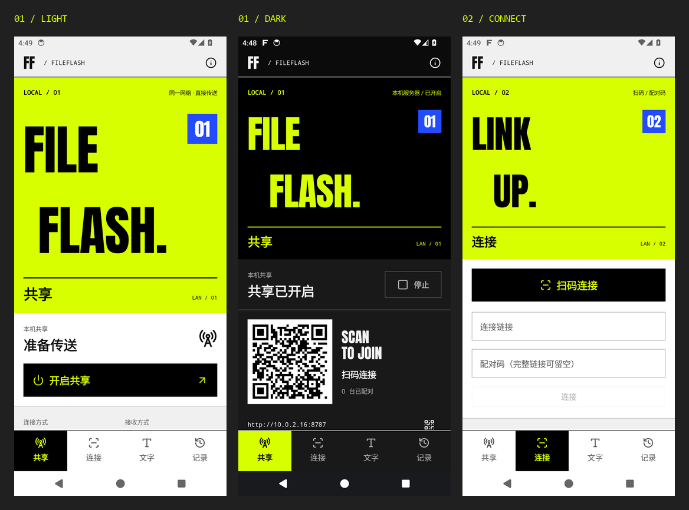
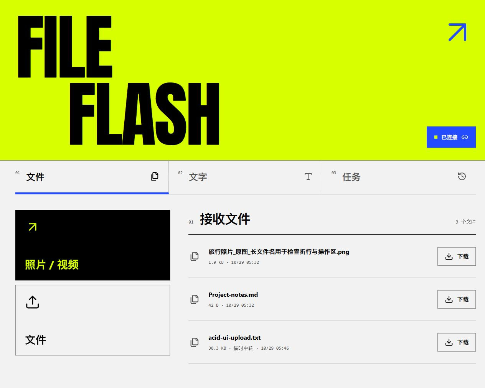
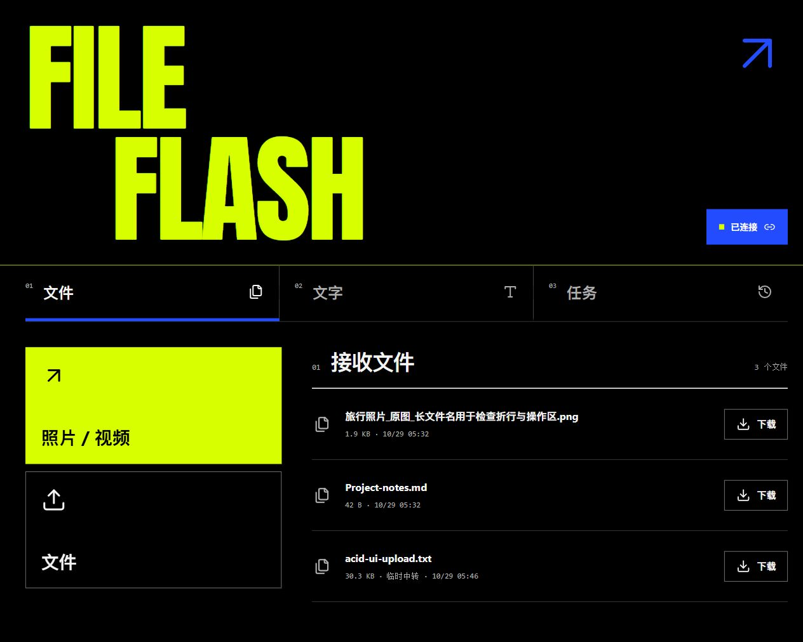

# 酸性设计 / 2.0.0

酸性设计已并入 `2.0.0` 主线。Android 与网页端采用统一的深浅主题、媒体缩略图和分类图标；移除多余滚动留白，更新手动清理并新增“下载目录”。[下载 2.0.0](https://github.com/Pitohui-Dichrous/FileFlash/releases/download/v2.0.0/FileFlash-2.0.0.apk)

[合并前实图与验证](acid-5/README.md) · [历史构建检查](acid-5/build-checks.json) · [媒体缩略图与文件图标](acid-4/README.md) · [故障效果与切角色差](acid-3/README.md) · [图标、切角与标题间距](acid-2/README.md)

以下保留各轮实验版本的原始记录，版本号、安装包摘要与验证范围均对应当时的构建。

## 第一轮（0.1.10-acid.1）

基于 `v0.1.10`（`d9a18b1`）重新设计 Android 与网页端，开发分支为 `codex/acid-design`。原 `codex/design` 分支已删除；当时 `main` 保持 0.1.10。

Anton 大字与错位断行构成页面主体；黑白灰承载操作区，荧光黄绿作为主视觉，电蓝标记章节与连接状态。四个原生页面、网页端、深浅色和窄屏布局均已实现。常用操作采用 Lucide 矢量图标，字体与图标本地打包。

视觉参考：[Kurppa Hosk × Bungie / Marathon](https://www.kurppahosk.com/work/bungie)。未使用游戏商标或游戏素材。[字体、图标与许可](ASSETS.md)。

## 第一轮安装包（历史）

实验版本：`0.1.10-acid.1`（15），Android 10 及以上。原签名，可覆盖安装。构建输出：`dist/FileFlash-0.1.10-acid.1.apk`。该轮未发布新的稳定版本。

SHA-256：`40c100ad7c69fe1da9d572b67b1b5ef1294c8af46f615cbfc0c91e7cf4235b17`

## 验证

- 85 项核心测试、22 项 Android 模型测试通过；发布构建与 Lint 通过。
- API 34 模拟器完成 17 项专项检查，包括四个页面、深浅色、320dp / 1.3 倍字体、输入法、缓存确认、跨页面接收进度和真实文件收发。
- 实际网页检查 320 / 390 / 1280px，完成配对、文字发送和文件上传；无横向溢出或浏览器错误日志。
- 传输逻辑、缓存逻辑和 iOS 快捷指令保持 0.1.10 实现。服务端仅新增本地字体静态资源路由。
- 本轮未操作实体手机；网页的 iOS 入口使用 Chromium 用户代理预览，不等于 iPhone 或快捷指令实机测试。

[构建验证](verification.json) · [Android 验证](native-checks.json) · [网页验证](web-runtime-checks.json) · [全部实图](screenshots/)

## 网页实图

预览图由实际运行截图等比缩小拼合；未改绘界面。截图中的测试会话已关闭，二维码已失效。
