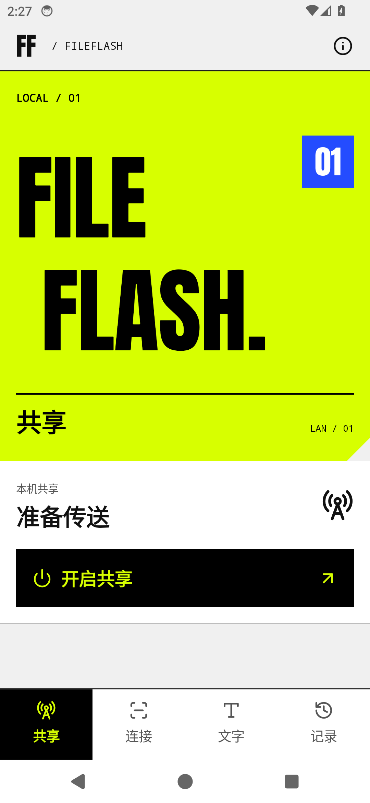
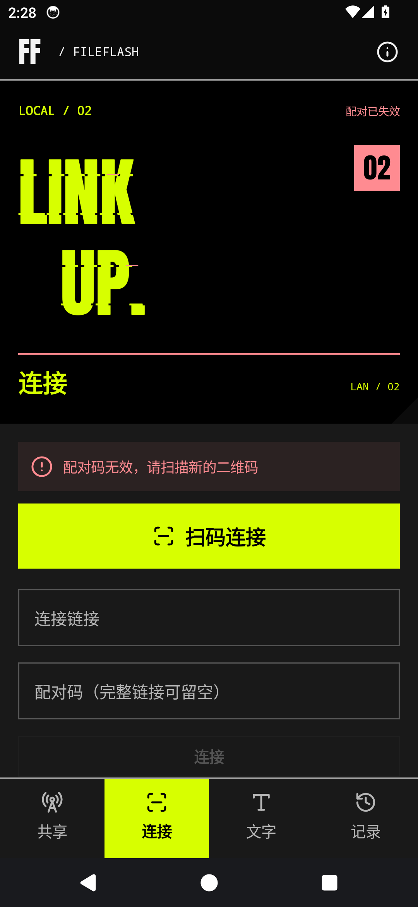

# ACID.02

`0.1.10-acid.2` · Android 10 及以上 · `codex/acid-design`

- 用户提供的 FF 原图作为应用图标，适配启动器与最近任务；网页标签图标同步。
- 四页标题块采用右下切角，并收紧两行大标题的间距。删除首页“同一网络 · 直接传送”和“连接方式 / 接收方式”说明栏。
- 配对失效时，大标题出现静态分段错位，编号、分隔线与警示使用红色。正文、输入和按钮不变形、不闪烁。
- 普通断网保持一般错误状态；重新配对恢复正常视觉。

布局参考本轮用户提供的 APPExtractor 浅色、深色截图，沿用大字、细线和硬边块面关系。图标原图及来源记录见 [资产说明](../ASSETS.md)。

安装包：`dist/FileFlash-0.1.10-acid.2.apk`，保留原签名，可覆盖安装。

SHA-256：`1d3e2672bc46bc050db51623fea4fa06f0c922f017301f66cafade52863666f8`

26 项模型测试通过，包括新增的 4 项失效状态分类测试；发布构建和 Lint 通过。Android 打包后的图标像素与用户原图一致。本轮未操作实体手机。

[构建验证](build-checks.json) · [连接与图标验证](runtime-checks.json) · [最终标题布局验证](final-layout-checks.json)

连接与图标验证在本轮候选包完成；其后仅收紧标题行距。报告和截图保留各自安装包摘要。

## 最终实图

| 首页 | 配对失效 |
| --- | --- |
|  |  |

[全部最终布局截图](final-layout/) · [启动器图标](screenshots/launcher.png) · [最近任务图标](screenshots/recent-tasks.png)
