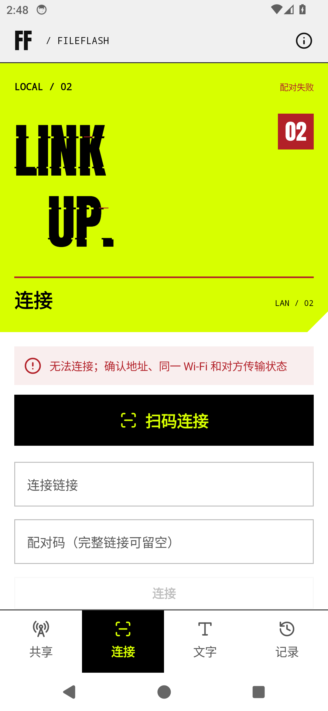
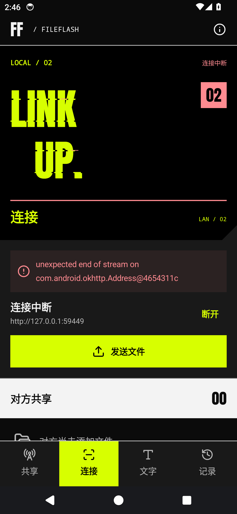
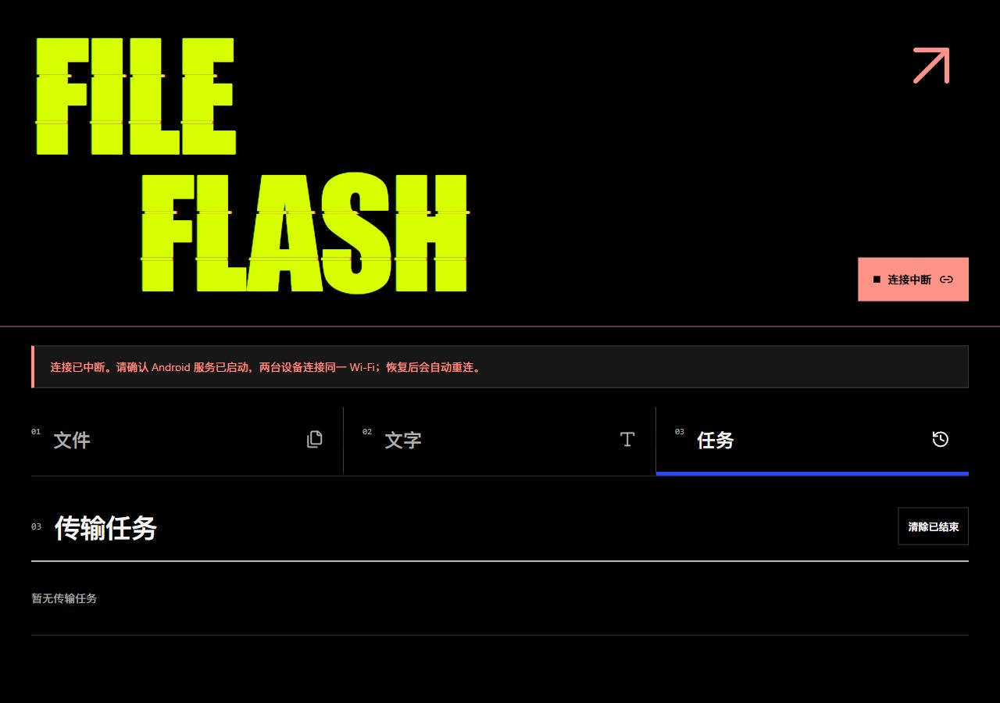

# ACID.03

`0.1.10-acid.3`（17），分支 `codex/acid-design`。

- APP 连接页、网页各标签页：配对失败、连接中断、配对失效均显示静态故障断片与红色警示，适配深浅主题。连接恢复后清除，主动断开不触发。
- 共享、连接页的切角底色与下方操作区统一。原先切角露出页面底色，而操作区使用另一种灰度；四组深浅主题像素对照现已完全相等。
- 网页忽略旧会话延迟返回的错误，避免主动断开或重新配对后错误显示故障。
- 保留已有标题行距、用户图标和传输实现。

## 安装包

`dist/FileFlash-0.1.10-acid.3.apk`，Android 10 及以上，原签名，可覆盖安装。主线维持 0.1.10。

SHA-256：`ed2021c0c9d8a725851ee78286436aaddf1b4cfdaef2b0b9de9f123ff42a528b`

## 验证

发布构建、Lint、APK 签名与资源核对通过。API 34 模拟器完成 9 项检查；浏览器实测深浅主题、320/390/1280px、配对失败、断网、重连和主动断开。4 项网页会话竞态回归通过。本轮未操作实体手机，未重复运行完整传输测试。

[构建](build-checks.json) · [APP 检查](native-checks.json) · [网页实测](web-runtime-checks.json) · [网页回归](web-code-checks.json)

## APP 实图

| 浅色：配对失败 | 深色：连接中断 |
| --- | --- |
|  |  |

## 网页实图

截图来自最终版本的实际运行。测试服务器和模拟器已关闭。
