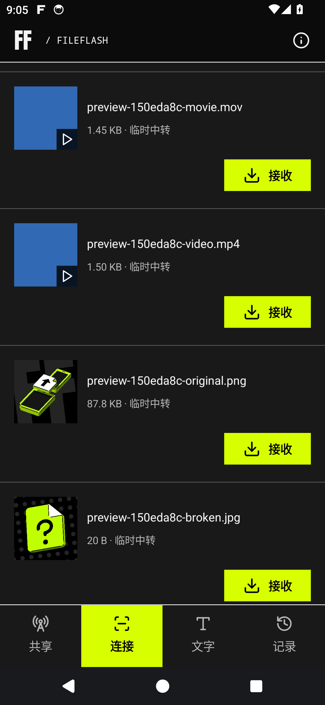
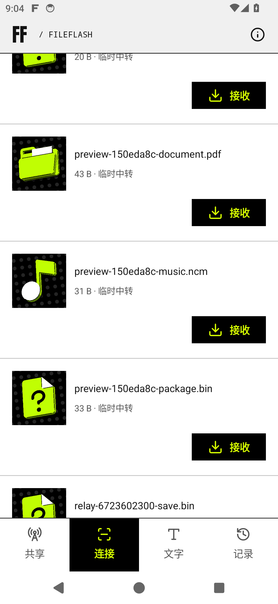
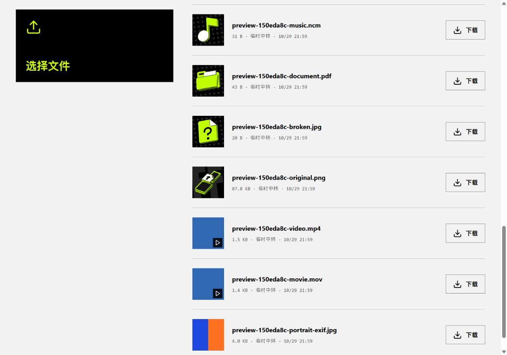

# ACID.04

`0.1.10-acid.4`（18），分支 `codex/acid-design`。

接收列表显示图片、视频缩略图，视频附播放标记。APP 的共享、临时文件和已保存列表同步显示预览。

| 文件类型 | 显示 |
| --- | --- |
| 图片、视频 | 服务器生成的小图；不支持或损坏时使用文件图标 |
| PDF、XML、TXT 等文档 | 原始 `documents-folder.svg` |
| MP3、WAV、NCM 等音频 | 原始 `audio-eighth-note.svg` |
| 其它文件 | 原始 `unknown-file.svg` |

三份 SVG 按用户原始字节打包，未改色、重绘或转换为位图资源。Android 直接解析并绘制矢量。

## 存储与传输

预览不下载完整媒体，不写入磁盘缓存。服务器生成最长边 256px、最多 256 KiB 的 JPEG，使用现有会话鉴权；预览不会创建下载任务或延长临时文件保留时间。

APP 的压缩缩略图内存缓存上限为 8 MiB，另有当前可见行的解码图片；系统内存回收、手动清理和连接切换时清空缓存。网页最多保留 16 张可见小图、最多 4 MiB 压缩数据，划出视区、切页或断开后取消请求并释放。传输与手动清理期间，正在读取的临时源文件受保护。

## 安装与验证

`dist/FileFlash-0.1.10-acid.4.apk`，Android 10 及以上，原签名，可覆盖安装。主线维持 0.1.10。

SHA-256：`42b0b0e59bea7986aac682528a5a03deab685b510e6e79ca5fce78730d9e6459`

94 项核心测试、26 项 Android 模型测试、6 组网页缩略图测试与 4 项连接竞态测试通过；构建、Lint、签名与打包资源核对通过。实际 API 34 模拟器与 Chromium 网页连接同一 Android 服务，检查图片、视频、EXIF 方向、无效媒体回退和深浅主题。未测试实体手机；媒体格式支持取决于服务器的系统解码器。

[构建与原始 SVG 核对](build-checks.json) · [APP 实测](native-checks.json) · [网页实测](web-runtime-checks.json)

| APP 媒体预览 | APP 文件分类 |
| --- | --- |
|  |  |

