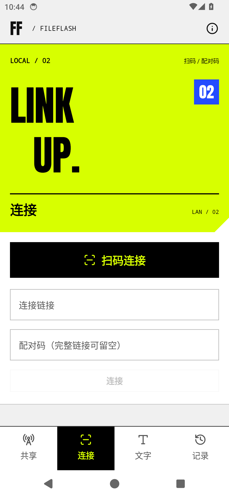
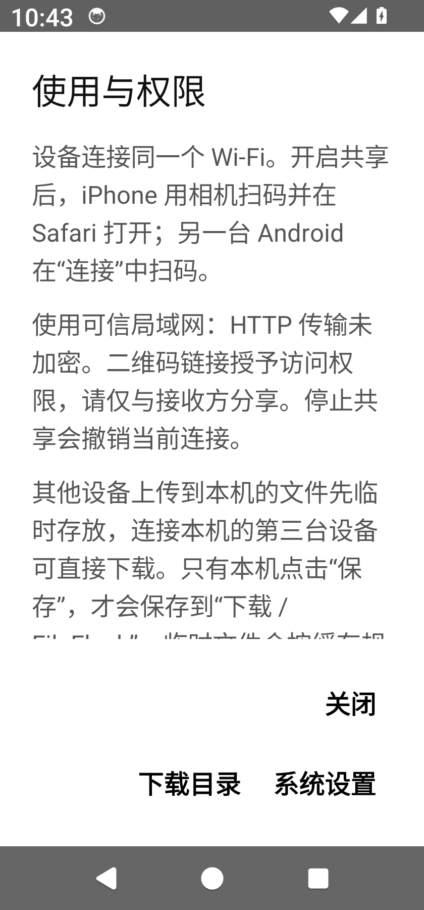

# ACID.05

`0.1.10-acid.5`（19），当时分支为 `codex/acid-design`，主线保持 0.1.10。Android 10 及以上，原签名，可覆盖安装。本页保留该轮验证记录；这些改动现已并入 2.0.0 主线。

- 移除连接页额外 96 dp、其它三页额外 24 dp 的列表尾部空白，并将空状态行上下留白收紧为 16 dp。内容超出屏幕时仍可正常滚动。
- “记录 → 清理”停止并丢弃未完成任务，清空任务历史、已保存历史、断点数据与临时中转文件。已经保存到系统 `Download/FileFlash` 的文件保留。
- “使用与权限”新增“下载目录”。优先打开 FileFlash 文件夹，文件管理器不支持时回退系统下载页。

保存与打开使用系统 Downloads 目录标识，不使用界面翻译后的路径。“下载”或“download”的显示名称不影响保存位置。

清理先阻止新任务进入，取消活动传输并等待读写结束，再删除应用私有数据。取消前已完整保存的公开文件保留。原始共享文件、文字与配对保留；已清理接收文件的共享入口移除。自动缓存清理规则不变，手动“清理”执行上述完整清理。

## 验证

安装包：`dist/FileFlash-0.1.10-acid.5.apk`。SHA-256：`ca029fcb4b969e1ebc9f9545a6305a7744174b988f12e4decdd162ccff564959`。

102 项核心测试、26 项 Android 模型测试通过；包含 8 项显式清理测试，覆盖传输取消、读写等待、旧请求拒绝、中断恢复、失败重试和公共源保护。构建、Lint、签名与 APK 资源核对通过。

[构建检查](build-checks.json) · [界面与目录检查](ui-checks.json) · [清理实测](cleanup-checks.json)

API 34 模拟器在 1080 × 2340 / 420 dpi、默认字体下，四页滑动前后元素坐标一致；320 dp / 1.3 倍字体下，帮助正文可滚动，三个操作按钮均可见、无重叠。深色连接页内容超出屏幕时可滚动至最后的连接按钮。下载目录直达 FileFlash；临时禁用目录处理器后，回退系统下载页成功。

在隔离测试数据中点击实际“保存”与“清理”按钮，确认活动 HTTP 上传和 APP 主动下载均停止，暂停/已校验待保存的数据、断点与两类历史被清空。强制结束后重启，旧记录未恢复。22 个原有公开文件和本轮实际保存的文件，共 23 个文件的 SHA-256 全部保持一致。

未操作实体手机。系统文件管理器的目录直达能力可能因厂商实现不同而回退到下载页。

测试结束后恢复原应用、私有数据与显示设置，删除本轮自有测试文件并关闭模拟器；原有 22 个公开文件再次核对完整。[环境恢复检查](restoration-checks.json)

| 连接页 | 320 dp / 1.3 倍字体 |
| --- | --- |
|  |  |

[文字页截图](text-fit.png) · [窄屏大字正常滚动](connection-narrow-large-dark.png)
